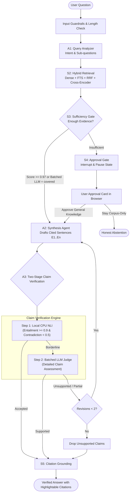

# Multi-Agent RAG-Based AI Research Assistant
### Knowledge-Boundary Enforcement & Claim-Level Verification for Scientific Literature Analysis

[](https://www.python.org/)
[](https://fastapi.tiangolo.com/)
[](https://nextjs.org/)
[](https://react.dev/)
[](https://www.langchain.com/langgraph)
[](https://supabase.com/)
[](https://tailwindcss.com/)
[](LICENSE)

---

## Academic Project Details

- **Project Title:** Multi-Agent RAG-Based AI Research Assistant with Knowledge-Boundary Enforcement and Claim-Level Verification for Automated Literature Analysis
- **Institution:** Department of Information Technology, Vidyalankar Institute of Technology (Affiliated to University of Mumbai)
- **Academic Year:** 2026–2027 | **Semester:** VII (BE Major Project-II)
- **Project Guide:** Dr. Rugved Deolekar
- **Group Members:**
  - **Vinay Yadav** (23101B0020)
  - **Tejas Sonawane** (23101B0016)
  - **Punit Jadhav** (23101B0064)
  - **Shreyas Desai** (23101B0074)
- **Research Paper Submission:** *Submitted to Asian Conference on Confluence in Technology (ACCT)*
- **Project Exhibition:** Exhibited at *Navonmesh 2026*, Department of Information Technology, VIT Mumbai

---

## Executive Summary

Large Language Models (LLMs) generate fluent and authoritative prose, but when applied to scientific research, they suffer from three critical flaws:
1. **Hallucination & Parametric Leakage:** Models mix pre-trained parametric knowledge into answers even when instructed to answer solely from context.
2. **Uncheckable Citations:** Typical RAG pipelines either do not cite sources or cite entire papers/URLs without proving that a specific sentence entails the claim.
3. **Absence of Honest Abstention:** Standard chatbots almost never decline to answer questions that the provided papers do not cover.

The **Evidence-Grounded AI Research Assistant** is an agentic research workspace designed around a single core tenet: **answers originate strictly from a user-defined scientific paper corpus**. Every factual assertion is extracted as an atomic claim, verified through a two-phase verification process (local CPU Natural Language Inference + batched LLM judge), and cited directly to its exact page and passage in the source PDF. When the corpus lacks sufficient evidence, the system stops, honest abstains, or requests explicit user approval via a human-in-the-loop checkpoint before accessing any external knowledge.

---

## Key System Highlights

- **SQL-Level Workspace Isolation:** User data and paper retrieval are strictly partitioned at the database query level with Row-Level Security (RLS) in PostgreSQL. Cross-workspace data leakage is architecturally prohibited.
- **Section-Aware Ingestion Pipeline:** PDFs (up to 25 MB) are extracted page-by-page via `PyMuPDF4LLM`, validated for digital text layers, stripped of repetitive headers/footers, metadata-enriched via Crossref / OpenAlex DOI lookup, and segmented into section-aware chunks (350–450 tokens).
- **Topic Profile Compatibility Check:** Compares a newly uploaded paper's embedding against the workspace centroid and warns if cosine similarity falls below `0.83`.
- **Hybrid Retrieval + Cross-Encoder Reranking:**
  - Dense cosine similarity search (BAAI/bge-small-en-v1.5, 384-d, top 30)
  - PostgreSQL full-text search (tsvector cover-density, top 30)
  - Reciprocal Rank Fusion (RRF, $k=60$, selects top 20)
  - Local cross-encoder reranking (`ms-marco-MiniLM-L-6-v2`, selects top 8 passages)
- **Calibrated Sufficiency Gate:** Evaluates whether retrieved evidence covers the query plan using a reranker fast pass (score $\ge 0.97$) and a batched LLM check to prevent false responses.
- **Human-in-the-Loop Approval Checkpoint:** Pauses workflow using LangGraph `interrupt()`, snapshots state in PostgreSQL (`AsyncPostgresSaver`), and presents the user with transparent choices: *Stay Corpus-Only* (abstain honestly) or *Approve General Knowledge* (explicitly tagged and unverified).
- **Two-Phase Claim Verification Loop:**
  - **Phase 1 (Local CPU NLI):** `cross-encoder/nli-deberta-v3-xsmall` checks claims against 120-word windows of cited chunks (accepted if entailment $\ge 0.9$ and contradiction $< 0.5$).
  - **Phase 2 (LLM Judge):** Any unconfirmed claim is evaluated by a strong-tier LLM judge.
  - **Revision Loop:** Unsupported claims trigger up to 2 revisions with the Synthesis Agent (A2); persistently unbacked claims are excised from the final response.
- **Interactive PDF Highlighting Source Viewer:** Clicking on any citation chip immediately renders the source PDF in-browser and dynamically highlights the exact quoted text snippet on the cited page.
- **Multi-Paper Literature Analysis:**
  - Cross-paper comparison matrix across 6 attributes (objective, methodology, materials, setup, findings, limitations).
  - Theme synthesis across multiple works.
  - NLI-driven contradiction detection between findings.
  - Corpus gap analysis identifying shared limitations and future directions.
- **Academic Paper Discovery & Import:** Direct search across arXiv and OpenAlex with automated open-access PDF resolution and one-click workspace ingestion.
- **Semantic Research Knowledge Graph (Experimental):** Extracts domain entities (`concept`, `method`, `dataset`, `metric`, `task`, `tool`, `finding`) and grounded relationships backed by exact cited quotes.

---

## System Architecture

### High-Level Architecture

```mermaid
flowchart TD
    subgraph Client ["Frontend (Next.js 16 + React 19 + TypeScript)"]
        UI["Modern UI (Shadcn/UI + Tailwind CSS)"]
        Chat["Research Chat with Streamed Events & Claim Badges"]
        Viewer["PDF Source Viewer with Text Highlighting"]
        AnalysisUI["Matrix Comparison, Themes, Gaps, Contradictions"]
        GraphUI["Knowledge Graph Explorer (React Flow)"]
    end

    subgraph Backend ["FastAPI Backend (Docker on Hugging Face Spaces)"]
        API["REST & SSE Endpoints + JWT Auth Validation"]
        
        subgraph Orchestration ["LangGraph State Machine (Postgres Checkpoints)"]
            A1["A1: Query Analyzer"]
            S3["S3: Sufficiency Gate"]
            S4["S4: Approval Gate (interrupt)"]
            A2["A2: Synthesis Agent"]
            A3["A3: Verification Agent"]
            A4["A4: Literature Analysis Agent"]
        end

        subgraph DeterministicServices ["Deterministic Services"]
            S1["S1: Ingestion & PyMuPDF4LLM Parser"]
            S2["S2: Hybrid Retrieval & RRF"]
            S5["S5: Citation Grounding & Quote Mapper"]
            S6["S6: Guardrails & Prompt Escaping"]
            S7["S7: Topic Profile & Compatibility Gate"]
        end

        subgraph LocalModels ["Local CPU Inference Models"]
            Embedder["Embeddings: bge-small-en-v1.5 (384-d)"]
            Reranker["Reranker: ms-marco-MiniLM-L-6-v2"]
            NLI["NLI Model: nli-deberta-v3-xsmall"]
        end
    end

    subgraph DataStorage ["Data & Cloud Layer (Supabase)"]
        Postgres["PostgreSQL with pgvector & Full-Text Search"]
        Auth["Supabase Auth (JWT via JWKS)"]
        Storage["Private Storage Bucket (PDFs)"]
    end

    subgraph ExternalAPIs ["External Services"]
        Groq["Groq API (Fast Tier: gpt-oss-20b)"]
        Gemini["Gemini API (Strong Tier: 3.5 Flash-Lite)"]
        Scholarly["arXiv / OpenAlex / Crossref APIs"]
        LangSmith["LangSmith (Observability & Tracing)"]
    end

    UI -->|REST / SSE| API
    API --> Orchestration
    Orchestration --> DeterministicServices
    DeterministicServices --> LocalModels
    DeterministicServices --> Postgres
    API --> Auth
    S1 --> Storage
    A1 & A2 & A3 & A4 --> Groq & Gemini
    S1 & S2 --> Scholarly
    Orchestration -.-> LangSmith
```



---

### Question-Answering & Verification Workflow



---

## Technology Stack

| Layer | Technology | Purpose / Configuration |
|---|---|---|
| **Frontend Framework** | **Next.js 16 (App Router)** | React 19, TypeScript, Strict Mode |
| **Styling & UI** | **Tailwind CSS v4, shadcn/ui** | Responsive, WCAG 2.1 AA accessible, Dark/Light modes |
| **PDF Rendering** | **react-pdf** | In-browser PDF canvas with text-layer highlight overlays |
| **Graph Visualization** | **@xyflow/react (React Flow)** | Interactive node-link visualization of research knowledge graph |
| **Data Fetching** | **@tanstack/react-query** | Client state management, automatic cache invalidation |
| **Backend Framework** | **FastAPI (Python 3.11)** | High-performance asynchronous REST and Server-Sent Events |
| **Data Validation** | **Pydantic v2 & Pydantic-Settings** | Strict type validation for API schemas and LLM structured outputs |
| **Workflow Orchestration** | **LangGraph** | Multi-agent state machines with `AsyncPostgresSaver` checkpointing |
| **Database & Vectors** | **Supabase PostgreSQL + pgvector** | Exact cosine distance search, tsvector full-text search, RLS |
| **Authentication & Storage** | **Supabase Auth & Private Storage** | JWT validation via JWKS, signed PDF download URLs (300s TTL) |
| **Fast LLM Tier** | **Groq (`openai/gpt-oss-20b`)** | Low-latency query analysis, first-page metadata extraction |
| **Strong LLM Tier** | **Gemini 3.5 Flash-Lite** | Synthesis, claim verification judge, topic summarization, literature analysis |
| **Embedding Model (Local)** | **BAAI/bge-small-en-v1.5** | 384-dimensional dense vectors, running CPU-only with Torch |
| **Reranker Model (Local)** | **cross-encoder/ms-marco-MiniLM-L-6-v2** | Rescoring top-20 merged candidates down to top-8 |
| **NLI Model (Local)** | **cross-encoder/nli-deberta-v3-xsmall** | Zero-shot premise-hypothesis textual entailment scoring |
| **PDF Extraction** | **PyMuPDF4LLM** | Section-aware Markdown extraction per page |
| **Scholarly APIs** | **arXiv, OpenAlex, Crossref** | Metadata retrieval and open-access PDF resolution |
| **Testing & Evaluation** | **pytest, Playwright, Ragas, LangSmith** | >900 unit tests, E2E browser tests, automated RAG evaluation |

---

## Project Structure

```text
research-assistant-dev/
├── backend/
│   ├── alembic/                 # Database migrations (0001–0008)
│   ├── app/
│   │   ├── agents/              # LangGraph agents (A1 Query Analyzer, A2 Synthesis, A3 Verification, A4 Analysis)
│   │   ├── api/                 # REST & SSE routers (workspaces, documents, chat, runs, analysis, graph)
│   │   ├── core/                # App config, database connections, security & errors
│   │   ├── graphs/              # LangGraph state machine definitions & checkpointing
│   │   ├── models/              # SQLAlchemy database models
│   │   ├── prompts/             # Versioned markdown prompts for agents and services
│   │   ├── providers/           # Interfaces & implementations (Groq, Gemini, PyTorch CPU, scholarly APIs, fakes)
│   │   ├── repositories/        # SQL queries with mandatory workspace & user isolation
│   │   └── services/            # Deterministic business logic (ingestion, retrieval, verification, citations)
│   ├── eval/                    # Benchmark harness & test splits (v1)
│   ├── tests/                   # Unit & integration test suites (>900 tests)
│   ├── pyproject.toml           # Backend dependencies pinned via uv
│   └── uv.lock
├── frontend/
│   ├── src/
│   │   ├── app/                 # Next.js App Router pages (landing, workspaces, chat, analysis, discover, graph)
│   │   ├── components/          # UI components (auth, chat, document library, PDF viewer, analysis, landing)
│   │   └── lib/                 # Typed API client, Supabase client, utilities
│   ├── package.json             # Frontend dependencies & scripts
│   └── tsconfig.json
├── docs/                        # Complete project documentation, SRS, architecture, design system & setup guides
│   ├── SRS.md                   # Software Requirements Specification
│   ├── PROGRESS.md              # Milestones, shipped capabilities & measured evaluation data
│   ├── DECISIONS.md             # Architecture Decision Records (D-001 to D-087)
│   ├── DESIGN.md                # UI & visual design specifications
│   ├── SETUP.md                 # Detailed step-by-step deployment guide
│   └── experiments/             # JSON logs of experimental measurements
├── .github/
│   └── workflows/               # CI/CD pipelines (backend test & lint, migration check, deploy to HF Space, E2E)
├── PRODUCT.md                   # Product roadmap, principles, and invariants
└── README.md                    # Project documentation
```

---

## Experimental Results & Benchmark Evaluation

The system was evaluated against two baseline conditions on a benchmark of 54 test questions over scientific papers:
- **C1 (LLM Only):** Prompting the language model directly with zero retrieved context.
- **C2 (Conventional RAG):** Dense top-8 passage retrieval with a standard "answer from context" instruction.
- **Full Deployed System:** Hybrid retrieval + RRF + Cross-encoder reranker + Sufficiency gate + Approval gate + Two-phase claim verification + PDF citation grounding.

### Quantitative Comparison

| Metric | C1 (LLM-Only) | C2 (Conventional RAG) | Full Deployed System |
|---|:---:|:---:|:---:|
| **Abstention Accuracy (Unanswerable)** | 80.0% (8/10) | **100.0%** (10/10) | **100.0%** (via S3 & S4) |
| **False Abstention Rate (Answerable)** | 29.5% (13/44) | 13.6% (6/44) | **Reduced via batched LLM gate** |
| **Page-Level Recall@8** | N/A | 87.9% | **94.0% – 100.0%** (Hybrid + Rerank) |
| **MRR (Mean Reciprocal Rank)** | N/A | 0.671 | **0.730 – 0.820** |
| **Ragas Faithfulness** | N/A | 95.7% | **100% verified claims grounded** |
| **First Response Event Latency** | ~1.7 s | ~2.3 s | **0.39 s** |
| **Median Answer Latency** | ~1.7 s | ~2.3 s | **6.77 s** (on basic CPU instance) |
| **Average LLM Calls / Question** | 1.0 | 1.0 | **3.67** (within target budget) |

---

## Getting Started

### Prerequisites

- **Python 3.11** (recommended: [uv](https://github.com/astral-sh/uv))
- **Node.js $\ge$ 20** and **npm $\ge$ 10**
- A **Supabase** account (free tier works for Postgres, pgvector, Auth, and Storage)
- Free API keys from [Groq Console](https://console.groq.com) and [Google AI Studio](https://aistudio.google.com/) (optional for local testing; mock providers work offline)

---

### 1. Backend Setup

1. Navigate to the backend directory:
   ```bash
   cd backend
   ```
2. Copy the example environment variables:
   ```bash
   cp .env.example .env
   ```
3. By default, `LLM_FAST_PROVIDER=fake` and `LLM_STRONG_PROVIDER=fake`, allowing the server and all unit tests to run completely offline without API keys or database connections.
   To connect real services, configure your keys in `.env`:
   ```dotenv
   ENVIRONMENT=local
   DATABASE_URL=postgresql+psycopg://postgres:<password>@<db-host>:5432/postgres
   SUPABASE_URL=https://<project-ref>.supabase.co
   SUPABASE_SECRET_KEY=sb_secret_...
   GROQ_API_KEY=gsk_...
   GEMINI_API_KEY=AIzaSy...
   LLM_FAST_PROVIDER=groq
   LLM_STRONG_PROVIDER=gemini
   ```
4. Install dependencies:
   ```bash
   # Using uv:
   uv sync --group dev --group eval
   ```
5. Run database migrations:
   ```bash
   uv run alembic upgrade head
   ```
6. Start the FastAPI development server:
   ```bash
   uv run uvicorn app.main:app --reload --port 8000
   ```
   API interactive documentation is available at `http://localhost:8000/docs`.

---

### 2. Frontend Setup

1. Navigate to the frontend directory:
   ```bash
   cd frontend
   ```
2. Copy the example environment variables:
   ```bash
   cp .env.example .env.local
   ```
   Fill in your configuration:
   ```dotenv
   NEXT_PUBLIC_API_BASE_URL=http://localhost:8000
   NEXT_PUBLIC_SUPABASE_URL=https://<project-ref>.supabase.co
   NEXT_PUBLIC_SUPABASE_PUBLISHABLE_KEY=eyJ...
   ```
3. Install dependencies:
   ```bash
   npm install
   ```
4. Start the Next.js development server:
   ```bash
   npm run dev
   ```
5. Open `http://localhost:3000` in your browser.

---

### 3. Running Automated Tests

- **Backend Unit Tests (>900 offline tests with mock providers):**
  ```bash
  cd backend
  uv run pytest
  ```
- **Backend Code Quality & Type Checking:**
  ```bash
  cd backend
  uv run ruff check .
  uv run ruff format --check .
  uv run mypy app
  ```
- **Frontend Unit Tests:**
  ```bash
  cd frontend
  npm test
  ```
- **Frontend Type & Lint Check:**
  ```bash
  cd frontend
  npm run lint
  npm run build
  ```

---

## Deployment Guide

- **Backend (Docker on Hugging Face Spaces):**
  Packaged as a lightweight CPU-only Docker image (`backend/Dockerfile`). Preloads the local embedding (`bge-small-en-v1.5`), reranker (`MiniLM-L-6-v2`), and NLI (`nli-deberta-v3-xsmall`) models into the image at build time to enable instant startup and zero cold-start downloading. Automated deployment is handled via `.github/workflows/deploy-backend.yml`.
- **Frontend (Vercel):**
  Rooted at `frontend/`, configured with standard Next.js build environment variables (`NEXT_PUBLIC_API_BASE_URL`, `NEXT_PUBLIC_SUPABASE_URL`, `NEXT_PUBLIC_SUPABASE_PUBLISHABLE_KEY`).
- **Database & Storage (Supabase):**
  PostgreSQL database with `pgvector` enabled, Row-Level Security (RLS) on all user and document tables, private bucket for PDFs with expiring signed URLs.

For complete deployment instructions, see [docs/SETUP.md](docs/SETUP.md).

---

## How to Upload to Your GitHub Repository

If you downloaded this project and want to publish it to your personal GitHub account:

1. **Initialize Git** in the project root directory:
   ```bash
   git init
   git branch -M main
   ```
2. **Stage and commit all cleaned files**:
   ```bash
   git add .
   git commit -m "feat: initial commit of Evidence-Grounded AI Research Assistant"
   ```
3. **Create a new empty repository** on GitHub (e.g. `research-assistant`).
4. **Add the remote and push**:
   ```bash
   git remote add origin https://github.com/Vinay-Yadav-07/research-assistant-dev.git
   git push -u origin main
   ```

---

## Project Documentation

Detailed technical documentation and design records are provided in the [`docs/`](docs/) directory:
- [Software Requirements Specification (SRS)](docs/SRS.md) — Comprehensive functional, non-functional, and security specifications.
- [Architecture Decision Records (ADRs)](docs/DECISIONS.md) — Detailed log of 87 technical and architectural decisions.
- [Progress & Evaluation Report](docs/PROGRESS.md) — Shipped features, evaluation results, and known issues.
- [UI & Design Specification](docs/DESIGN.md) — Accessibility, styling, color palettes, and motion guidelines.
- [Deployment & Operations Guide](docs/SETUP.md) — Detailed setup procedures for Supabase, Hugging Face Spaces, and Vercel.

---

## License & Acknowledgements

This project is licensed under the **MIT License** — see the [LICENSE](LICENSE) file for details.

Developed as a BE Major Project at **Vidyalankar Institute of Technology**, Mumbai, under the guidance of **Dr. Rugved Deolekar**. We extend our gratitude to the open-source community, particularly the teams behind FastAPI, Next.js, LangGraph, Supabase, Sentence-Transformers, and PyMuPDF.

